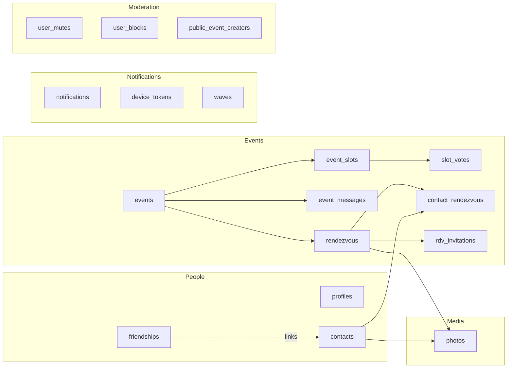
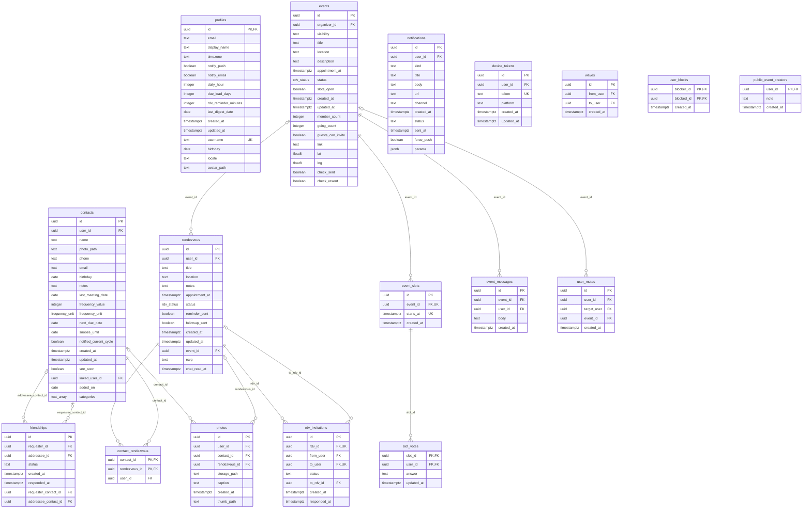
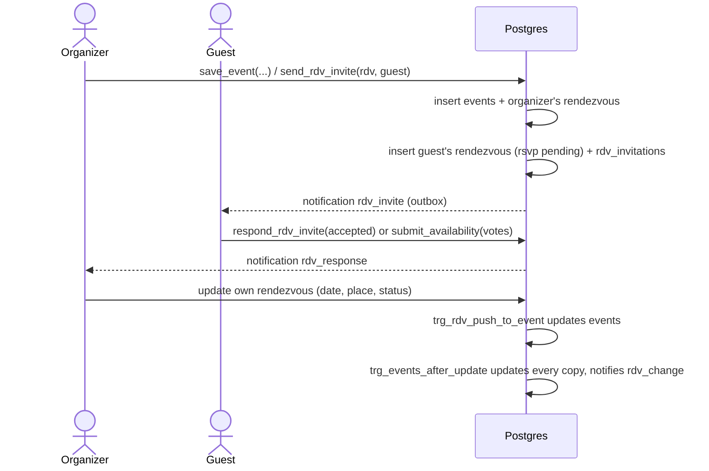
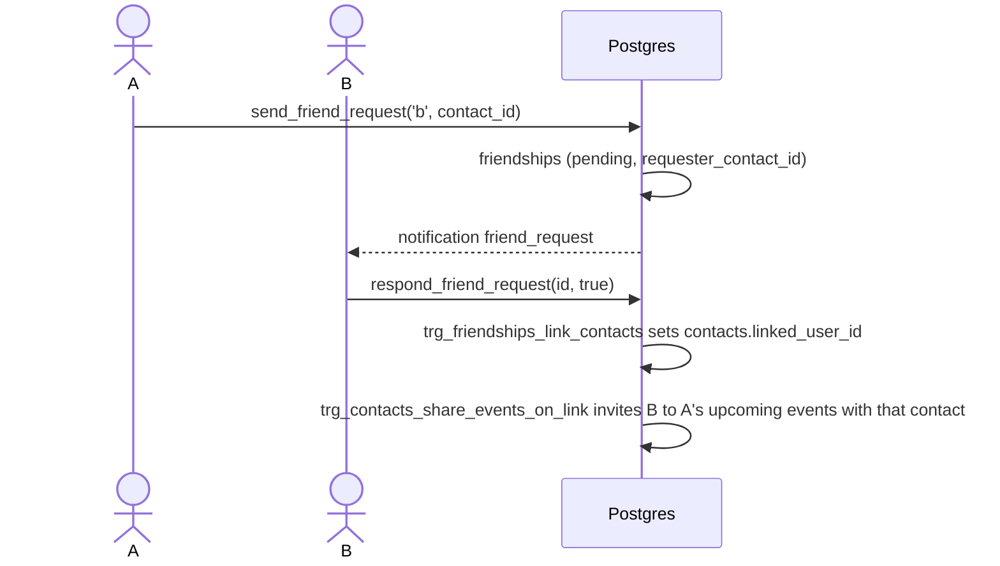
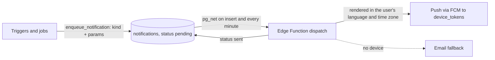

# SeeU — Database

Supabase Postgres, project **SeeU** (`klqzmegiydmwtmxfguvl`). This page describes the
`public` schema as deployed (generated from production's catalog on 2026-11-16, after
migration `0011`), plus the storage buckets, jobs and the main flows.
Source of truth: [`supabase/migrations/`](../supabase/migrations) (applied in order);
SQL scenario tests: [`supabase/tests/`](../supabase/tests/README.md).

## 1. Conventions

| Convention | Rule |
| --- | --- |
| Primary keys | `uuid`, default `gen_random_uuid()`. Link tables use a composite PK (`contact_rendezvous`, `slot_votes`, `user_blocks`). `profiles.id` **is** the auth user id. |
| Users | Every "user" column (`user_id`, `organizer_id`, `from_user`, …) references `auth.users(id)`; deleting an account cascades to its rows. Public identity lives in `profiles`. |
| Naming | `snake_case`, plural table names, `*_id` for foreign keys, `*_at` = `timestamptz`, days without time = `date`, booleans named as states (`see_soon`, `slots_open`). |
| Timestamps | `created_at` / `updated_at` default `now()`; `updated_at` maintained by triggers. Instants are UTC (`timestamptz`); per-user days use `profiles.timezone`. |
| Enumerations | Two Postgres enums (below); other closed lists are `text` + `CHECK` (`status`, `visibility`, `rsvp`, `answer`…). |
| Security | **RLS on every table.** Direct table access is limited to the owner's own rows; anything shared (friends, events, invitations) goes through `SECURITY DEFINER` functions that check membership. Internal functions are revoked from the app roles. |
| Errors | Functions raise stable codes `seeu:<code>` (e.g. `seeu:not_organizer`), translated by the app (`lib/core/errors.dart`). |
| Diagrams | Keys: **PK** primary key, **FK** foreign key, **UK** unique. Crow's foot: `||` exactly one, `|o` zero or one, `o{` zero or many. |

## 2. Enumerations

| Type | Values | Meaning |
| --- | --- | --- |
| `frequency_unit` | `days`, `weeks`, `months`, `years`, `never` | How often to see a contact (`never` = no recurring reminder) |
| `rdv_status` | `planifie`, `valide`, `annule` | Planned / happened / cancelled |

## 3. Overview

- **People**: my private `contacts` (an address book with a meeting frequency) and SeeU
  `friendships` between accounts; a contact can be linked to a friend's account.
- **Events**: one `events` row holds what's shared; each participant has their own
  `rendezvous` copy (notes, RSVP, which of their contacts take part).
- **Notifications**: an outbox table filled by triggers and jobs, delivered by an Edge Function.

## 4. Entity–relationship diagram

All columns, with keys, and the links between tables. Links to Supabase's `auth.users`
(the account) are listed below the diagram rather than drawn, to keep it readable.

| Table | Columns referencing `auth.users(id)` |
| --- | --- |
| `profiles` | `id` (on delete cascade) |
| `contacts` | `linked_user_id` (on delete set null), `user_id` (on delete cascade) |
| `events` | `organizer_id` (on delete cascade) |
| `rendezvous` | `user_id` (on delete cascade) |
| `contact_rendezvous` | `user_id` (on delete cascade) |
| `slot_votes` | `user_id` (on delete cascade) |
| `event_messages` | `user_id` (on delete cascade) |
| `friendships` | `requester_id` (on delete cascade), `addressee_id` (on delete cascade) |
| `rdv_invitations` | `from_user` (on delete cascade), `to_user` (on delete cascade) |
| `photos` | `user_id` (on delete cascade) |
| `notifications` | `user_id` (on delete cascade) |
| `device_tokens` | `user_id` (on delete cascade) |
| `waves` | `from_user` (on delete cascade), `to_user` (on delete cascade) |
| `user_mutes` | `user_id` (on delete cascade), `target_user` (on delete cascade) |
| `user_blocks` | `blocked_id` (on delete cascade), `blocker_id` (on delete cascade) |
| `public_event_creators` | `user_id` (on delete cascade) |

## 5. Tables

### `profiles`

One row per account (same `id` as `auth.users`), created by the `handle_new_user` trigger at sign-up. Settings, public identity (`username`, `display_name`, `avatar_path`) and notification preferences. `email` is kept for technical use only (auth, email fallback) and is never sent to other users.

| Column | Type | Null | Default | Key / notes |
| --- | --- | --- | --- | --- |
| `id` | uuid | no |  | **PK**, FK → `auth.users.id` (on delete cascade) |
| `email` | text | yes |  |  |
| `display_name` | text | yes |  |  |
| `timezone` | text | no | `'Europe/Paris'` |  |
| `notify_push` | boolean | no | `true` |  |
| `notify_email` | boolean | no | `true` |  |
| `daily_hour` | integer | no | `8` |  |
| `due_lead_days` | integer | no | `0` |  |
| `rdv_reminder_minutes` | integer | no | `30` |  |
| `last_digest_date` | date | yes |  |  |
| `created_at` | timestamptz | no | `now()` |  |
| `updated_at` | timestamptz | no | `now()` |  |
| `username` | text | yes |  | **UK** |
| `birthday` | date | yes |  |  |
| `locale` | text | no | `'fr'` |  |
| `avatar_path` | text | yes |  |  |

- Unique index `idx_profiles_username` on `(username)`
- Check: `(((daily_hour >= 0) AND (daily_hour <= 23)))`
- Check: `(((due_lead_days >= 0) AND (due_lead_days <= 30)))`
- Check: `(((rdv_reminder_minutes >= 5) AND (rdv_reminder_minutes <= 1440)))`
- Check: `((username ~ '^[a-z0-9][a-z0-9_.]{2,19}$'::text))`
- Check: `((locale ~ '^[a-z]{2}$'::text))`
- RLS: `profiles_insert_own` (insert), `profiles_select_own` (select), `profiles_update_own` (update)
- Triggers: `trg_profiles_birthday`, `trg_profiles_check_tz`, `trg_profiles_updated`, `trg_profiles_username_fixed`

### `contacts`

My private address book: one card per person I want to keep seeing. `next_due_date` is computed from the last meeting (or `added_on`) and the frequency; `frequency_unit = 'never'` means no recurring reminder (no due date). `linked_user_id` links the card to that person's SeeU account.

| Column | Type | Null | Default | Key / notes |
| --- | --- | --- | --- | --- |
| `id` | uuid | no | `gen_random_uuid()` | **PK** |
| `user_id` | uuid | no |  | FK → `auth.users.id` (on delete cascade) |
| `name` | text | no |  |  |
| `photo_path` | text | yes |  |  |
| `phone` | text | yes |  |  |
| `email` | text | yes |  |  |
| `birthday` | date | yes |  |  |
| `notes` | text | yes |  |  |
| `last_meeting_date` | date | yes |  |  |
| `frequency_value` | integer | no |  |  |
| `frequency_unit` | frequency_unit | no |  |  |
| `next_due_date` | date | yes |  | generated |
| `snooze_until` | date | yes |  |  |
| `notified_current_cycle` | boolean | no | `false` |  |
| `created_at` | timestamptz | no | `now()` |  |
| `updated_at` | timestamptz | no | `now()` |  |
| `see_soon` | boolean | no | `false` |  |
| `linked_user_id` | uuid | yes |  | FK → `auth.users.id` (on delete set null) |
| `added_on` | date | no | `CURRENT_DATE` |  |
| `categories` | text[] | no | `'{}'[]` |  |

- Unique index `idx_contacts_linked_user` on `(user_id, linked_user_id)` where `(linked_user_id IS NOT NULL)`
- Check: `((cardinality(categories) <= 10))`
- Check: `(((char_length(name) >= 1) AND (char_length(name) <= 120)))`
- Check: `(((frequency_value > 0) AND (frequency_value <= 1000)))`
- RLS: `contacts_own` (all)
- Triggers: `trg_contacts_before_update`, `trg_contacts_check_link`, `trg_contacts_share_events_on_link`

### `events`

The shared part of a rendezvous: organizer, visibility, date / timeslot poll, place (+ map coordinates), link, description, counters. Only the organizer changes it (through `save_event` / their own copy).

| Column | Type | Null | Default | Key / notes |
| --- | --- | --- | --- | --- |
| `id` | uuid | no | `gen_random_uuid()` | **PK** |
| `organizer_id` | uuid | no |  | FK → `auth.users.id` (on delete cascade) |
| `visibility` | text | no | `'private'` |  |
| `title` | text | yes |  |  |
| `location` | text | yes |  |  |
| `description` | text | yes |  |  |
| `appointment_at` | timestamptz | no |  |  |
| `status` | rdv_status | no | `'planifie'` |  |
| `slots_open` | boolean | no | `false` |  |
| `created_at` | timestamptz | no | `now()` |  |
| `updated_at` | timestamptz | no | `now()` |  |
| `member_count` | integer | no | `0` |  |
| `going_count` | integer | no | `0` |  |
| `guests_can_invite` | boolean | no | `true` |  |
| `link` | text | yes |  |  |
| `lat` | float8 | yes |  |  |
| `lng` | float8 | yes |  |  |
| `check_sent` | boolean | no | `false` |  |
| `check_resent` | boolean | no | `false` |  |

- Check: `((char_length(title) <= 120))`
- Check: `((visibility = ANY (ARRAY['private'::text, 'contacts'::text, 'public'::text])))`
- Check: `((char_length(description) <= 2000))`
- Check: `((char_length(location) <= 200))`
- RLS: `events_select_visible` (select)
- Triggers: `trg_events_after_update`, `trg_events_reset_checks`, `trg_events_updated`

### `rendezvous`

My copy of an event ("rendez-vous"): every participant has their own row, holding personal data (notes, contacts attached, RSVP, reminder flags). Shared fields (title, place, date, status) are mirrored from `events` by triggers.

| Column | Type | Null | Default | Key / notes |
| --- | --- | --- | --- | --- |
| `id` | uuid | no | `gen_random_uuid()` | **PK** |
| `user_id` | uuid | no |  | FK → `auth.users.id` (on delete cascade) |
| `title` | text | yes |  |  |
| `location` | text | yes |  |  |
| `notes` | text | yes |  |  |
| `appointment_at` | timestamptz | no |  |  |
| `status` | rdv_status | no | `'planifie'` |  |
| `reminder_sent` | boolean | no | `false` |  |
| `followup_sent` | boolean | no | `true` |  |
| `created_at` | timestamptz | no | `now()` |  |
| `updated_at` | timestamptz | no | `now()` |  |
| `event_id` | uuid | yes |  | FK → `events.id` (on delete set null) |
| `rsvp` | text | yes |  |  |
| `chat_read_at` | timestamptz | yes |  |  |

- Unique index `idx_rdv_event_user` on `(event_id, user_id)` where `(event_id IS NOT NULL)`
- Check: `((rsvp = ANY (ARRAY['pending'::text, 'accepted'::text, 'declined'::text])))`
- RLS: `rdv_own` (all)
- Triggers: `trg_rdv_after_write`, `trg_rdv_before_update`, `trg_rdv_counts`, `trg_rdv_drop_votes_on_leave`, `trg_rdv_guard_shared`, `trg_rdv_push_to_event`

### `contact_rendezvous`

Which of my contacts take part in my copy of an event (many-to-many, per user).

| Column | Type | Null | Default | Key / notes |
| --- | --- | --- | --- | --- |
| `contact_id` | uuid | no |  | **PK**, FK → `contacts.id` (on delete cascade) |
| `rendezvous_id` | uuid | no |  | **PK**, FK → `rendezvous.id` (on delete cascade) |
| `user_id` | uuid | no |  | FK → `auth.users.id` (on delete cascade) |

- RLS: `cr_delete_own` (delete), `cr_insert_own` (insert), `cr_select_own` (select)
- Triggers: `trg_cr_after_insert`

### `event_slots`

Proposed timeslots of an event whose date isn't chosen yet (`events.slots_open`).

| Column | Type | Null | Default | Key / notes |
| --- | --- | --- | --- | --- |
| `id` | uuid | no | `gen_random_uuid()` | **PK** |
| `event_id` | uuid | no |  | FK → `events.id` (on delete cascade), UK (event_id, starts_at) |
| `starts_at` | timestamptz | no |  | UK (event_id, starts_at) |
| `created_at` | timestamptz | no | `now()` |  |

- RLS: `event_slots_select_members` (select)

### `slot_votes`

Each participant's answer per timeslot (yes / maybe / no). The organizer doesn't vote.

| Column | Type | Null | Default | Key / notes |
| --- | --- | --- | --- | --- |
| `slot_id` | uuid | no |  | **PK**, FK → `event_slots.id` (on delete cascade) |
| `user_id` | uuid | no |  | **PK**, FK → `auth.users.id` (on delete cascade) |
| `answer` | text | no |  |  |
| `updated_at` | timestamptz | no | `now()` |  |

- Check: `((answer = ANY (ARRAY['yes'::text, 'maybe'::text, 'no'::text])))`
- RLS: `slot_votes_select_members` (select)
- Triggers: `trg_slot_votes_not_organizer`

### `event_messages`

Event chat (or announcements on public events). Live through Supabase Realtime.

| Column | Type | Null | Default | Key / notes |
| --- | --- | --- | --- | --- |
| `id` | uuid | no | `gen_random_uuid()` | **PK** |
| `event_id` | uuid | no |  | FK → `events.id` (on delete cascade) |
| `user_id` | uuid | no |  | FK → `auth.users.id` (on delete cascade) |
| `body` | text | no |  |  |
| `created_at` | timestamptz | no | `now()` |  |

- Check: `(((char_length(TRIM(BOTH FROM body)) >= 1) AND (char_length(TRIM(BOTH FROM body)) <= 2000)))`
- RLS: `event_messages_delete_own` (delete), `event_messages_insert_members` (insert), `event_messages_select_members` (select)
- Triggers: `trg_notify_event_message`

### `friendships`

SeeU friend requests and friendships (one row per pair). The `*_contact_id` columns remember which contact card each side wants linked once accepted.

| Column | Type | Null | Default | Key / notes |
| --- | --- | --- | --- | --- |
| `id` | uuid | no | `gen_random_uuid()` | **PK** |
| `requester_id` | uuid | no |  | FK → `auth.users.id` (on delete cascade) |
| `addressee_id` | uuid | no |  | FK → `auth.users.id` (on delete cascade) |
| `status` | text | no | `'pending'` |  |
| `created_at` | timestamptz | no | `now()` |  |
| `responded_at` | timestamptz | yes |  |  |
| `requester_contact_id` | uuid | yes |  | FK → `contacts.id` (on delete set null) |
| `addressee_contact_id` | uuid | yes |  | FK → `contacts.id` (on delete set null) |

- Unique index `idx_friendships_pair` on `(LEAST(requester_id, addressee_id), GREATEST(requester_id, addressee_id))`
- Check: `((requester_id <> addressee_id))`
- Check: `((status = ANY (ARRAY['pending'::text, 'accepted'::text])))`
- RLS: `friendships_delete_mine` (delete), `friendships_select_mine` (select)
- Triggers: `trg_friendships_after_delete`, `trg_friendships_before_insert`, `trg_friendships_link_contacts`, `trg_notify_friendship`

### `rdv_invitations`

Invitation of a friend to one of my events. `to_rdv_id` is the invitee's copy (created at once, RSVP "à confirmer").

| Column | Type | Null | Default | Key / notes |
| --- | --- | --- | --- | --- |
| `id` | uuid | no | `gen_random_uuid()` | **PK** |
| `rdv_id` | uuid | no |  | FK → `rendezvous.id` (on delete cascade), UK (rdv_id, to_user) |
| `from_user` | uuid | no |  | FK → `auth.users.id` (on delete cascade) |
| `to_user` | uuid | no |  | FK → `auth.users.id` (on delete cascade), UK (rdv_id, to_user) |
| `status` | text | no | `'pending'` |  |
| `to_rdv_id` | uuid | yes |  | FK → `rendezvous.id` (on delete set null) |
| `created_at` | timestamptz | no | `now()` |  |
| `responded_at` | timestamptz | yes |  |  |

- Check: `((status = ANY (ARRAY['pending'::text, 'accepted'::text, 'declined'::text])))`
- RLS: `rdv_inv_delete_sender` (delete), `rdv_inv_select_mine` (select)
- Triggers: `trg_check_guest_invite`, `trg_notify_rdv_invitation`, `trg_rdv_invitations_after_delete`

### `photos`

Photos of a contact or of an event, stored in the private `photos` bucket (`storage_path`, `thumb_path`).

| Column | Type | Null | Default | Key / notes |
| --- | --- | --- | --- | --- |
| `id` | uuid | no | `gen_random_uuid()` | **PK** |
| `user_id` | uuid | no |  | FK → `auth.users.id` (on delete cascade) |
| `contact_id` | uuid | yes |  | FK → `contacts.id` (on delete cascade) |
| `rendezvous_id` | uuid | yes |  | FK → `rendezvous.id` (on delete cascade) |
| `storage_path` | text | no |  |  |
| `caption` | text | yes |  |  |
| `created_at` | timestamptz | no | `now()` |  |
| `thumb_path` | text | yes |  |  |

- Check: `(((contact_id IS NOT NULL) OR (rendezvous_id IS NOT NULL)))`
- RLS: `photos_delete_own` (delete), `photos_insert_own` (insert), `photos_select_own` (select), `photos_update_own` (update)

### `notifications`

Notification outbox: rows are queued by triggers / jobs (`kind` + `params`), then rendered in the recipient's language and delivered by the `dispatch` Edge Function (push, else email).

| Column | Type | Null | Default | Key / notes |
| --- | --- | --- | --- | --- |
| `id` | uuid | no | `gen_random_uuid()` | **PK** |
| `user_id` | uuid | no |  | FK → `auth.users.id` (on delete cascade) |
| `kind` | text | no |  |  |
| `title` | text | yes |  |  |
| `body` | text | yes |  |  |
| `url` | text | yes |  |  |
| `channel` | text | no | `'none'` |  |
| `created_at` | timestamptz | no | `now()` |  |
| `status` | text | no | `'pending'` |  |
| `sent_at` | timestamptz | yes |  |  |
| `force_push` | boolean | no | `false` |  |
| `params` | jsonb | no | `'{}'` |  |

- Check: `((status = ANY (ARRAY['pending'::text, 'sending'::text, 'sent'::text])))`
- RLS: `notifications_delete_own` (delete), `notifications_select_own` (select)

### `device_tokens`

Push tokens (FCM) of each user's devices.

| Column | Type | Null | Default | Key / notes |
| --- | --- | --- | --- | --- |
| `id` | uuid | no | `gen_random_uuid()` | **PK** |
| `user_id` | uuid | no |  | FK → `auth.users.id` (on delete cascade) |
| `token` | text | no |  | **UK** |
| `platform` | text | no |  |  |
| `created_at` | timestamptz | no | `now()` |  |
| `updated_at` | timestamptz | no | `now()` |  |

- Check: `((platform = ANY (ARRAY['android'::text, 'ios'::text])))`
- RLS: `device_tokens_delete_own` (delete), `device_tokens_select_own` (select)

### `waves`

"Envie de se voir": a friend signals they'd like to meet (max one per 24 h per friend).

| Column | Type | Null | Default | Key / notes |
| --- | --- | --- | --- | --- |
| `id` | uuid | no | `gen_random_uuid()` | **PK** |
| `from_user` | uuid | no |  | FK → `auth.users.id` (on delete cascade) |
| `to_user` | uuid | no |  | FK → `auth.users.id` (on delete cascade) |
| `created_at` | timestamptz | no | `now()` |  |

- Check: `((from_user <> to_user))`
- RLS: `waves_select_mine` (select)
- Triggers: `trg_notify_wave`

### `user_mutes`

Muted people or events (no notifications, hidden from feeds). Exactly one of `target_user` / `event_id`.

| Column | Type | Null | Default | Key / notes |
| --- | --- | --- | --- | --- |
| `id` | uuid | no | `gen_random_uuid()` | **PK** |
| `user_id` | uuid | no |  | FK → `auth.users.id` (on delete cascade) |
| `target_user` | uuid | yes |  | FK → `auth.users.id` (on delete cascade) |
| `event_id` | uuid | yes |  | FK → `events.id` (on delete cascade) |
| `created_at` | timestamptz | no | `now()` |  |

- Unique index `idx_user_mutes_user` on `(user_id, target_user)` where `(target_user IS NOT NULL)`
- Unique index `idx_user_mutes_event` on `(user_id, event_id)` where `(event_id IS NOT NULL)`
- Check: `((num_nonnulls(target_user, event_id) = 1))`
- Check: `((target_user IS DISTINCT FROM user_id))`
- RLS: `user_mutes_own` (all)

### `user_blocks`

Blocked people (both directions are hidden from each other).

| Column | Type | Null | Default | Key / notes |
| --- | --- | --- | --- | --- |
| `blocker_id` | uuid | no |  | **PK**, FK → `auth.users.id` (on delete cascade) |
| `blocked_id` | uuid | no |  | **PK**, FK → `auth.users.id` (on delete cascade) |
| `created_at` | timestamptz | no | `now()` |  |

- Check: `((blocker_id <> blocked_id))`
- RLS: `user_blocks_delete_own` (delete), `user_blocks_select_own` (select)

### `public_event_creators`

Who may publish **public** events. No app access: managed in the SQL editor (see SETUP).

| Column | Type | Null | Default | Key / notes |
| --- | --- | --- | --- | --- |
| `user_id` | uuid | no |  | **PK**, FK → `auth.users.id` (on delete cascade) |
| `note` | text | yes |  |  |
| `created_at` | timestamptz | no | `now()` |  |

- RLS: enabled, **no policy** (no direct app access; only through functions)

## 6. Functions

App-callable (granted to `authenticated`, called with `supabase.rpc(...)`):

| Area | Functions |
| --- | --- |
| Profile | `username_available`, `search_users`, `profile_avatars`, `register_device`, `send_test_notification` |
| Friends | `send_friend_request(username, contact?)`, `respond_friend_request`, `list_friends`, `send_wave` |
| Events | `save_event(jsonb)`, `get_event`, `list_feed_events`, `join_event`, `list_event_participants`, `list_event_guests`, `send_rdv_invite`, `respond_rdv_invite`, `list_rdv_invites`, `list_shared_rdv_photos` |
| Timeslots | `list_event_slots`, `vote_slot`, `submit_availability`, `choose_event_slot` |
| Chat | `list_event_messages` (posting is a plain insert, checked by RLS) |
| Moderation | `block_user`, `unblock_user`, `list_blocked_users`, `list_mutes`, `can_create_public_events` |

Internal (revoked from the app; used by triggers, jobs and other functions):
`save_event_core`, `apply_event_guest_option`, `set_event_slots`, `refresh_event_counts`,
`send_rdv_invite_as`, `link_contact_internal`, `copy_contact_for`, `ensure_friend_contact`,
`block_user_core`, `are_friends`, `is_blocked`, `is_muted`, `display_name_of`, `user_tz`,
`event_params`, `enqueue_notification`, `request_dispatch`, `dispatch_if_pending`,
`broadcast_event`, `run_reminders`, `run_event_checks`.

Trigger functions (the `trg_*` listed per table) keep copies in sync, maintain counters and
queue notifications.

## 7. Storage

| Bucket | Public | Max size | Path | Access |
| --- | --- | --- | --- | --- |
| `photos` | no | 10 MB | `<user_id>/<random>.jpg` (+ thumbnail) | Owner read/write; participants of a shared event read its photos (`photos_storage_select_shared`); the app uses signed URLs (1 h) |
| `avatars` | yes | 2 MB | `<user_id>/<random>.jpg` | Anyone with the (unguessable) URL reads; only the owner writes, lists, deletes |

## 8. Jobs and realtime

| pg_cron job | Schedule | Runs |
| --- | --- | --- |
| `seeu-dispatch` | every minute | `dispatch_if_pending()`: wakes the `dispatch` Edge Function if notifications wait |
| `seeu-reminders` | every 10 min | `run_reminders()`: event reminders, daily digest of contacts to see, birthdays |
| `seeu-event-checks` | every 10 min | `run_event_checks()`: "is it happening?" to the organizer at the start and 4 h later, auto "happened" after 24 h |

Realtime publication `supabase_realtime`: `event_messages` (live chat).

## 9. Main flows

### Event shared between participants

Only the organizer changes shared fields or the status (`rdv_guard_shared` raises
`seeu:not_organizer` otherwise). A status `valide` updates each participant's contacts'
last meeting date through their own copy.

### Friend request tied to a contact

### Notifications

## 10. Changing the schema

1. Add a new file `supabase/migrations/<yyyymmdd><nnnnnn>_<name>.sql` (never edit an applied one).
2. Test it on the throw-away database (see `supabase/tests/README.md`), with a scenario file.
3. Apply: `supabase db push --remote --yes`, then check with
   `supabase db query --remote --read-only "..."`.
4. Functions whose **returned columns** change must be dropped and re-created, then re-granted
   (`create or replace` refuses it).
5. Update this page (the tables in §4–5 are generated from the catalog).
