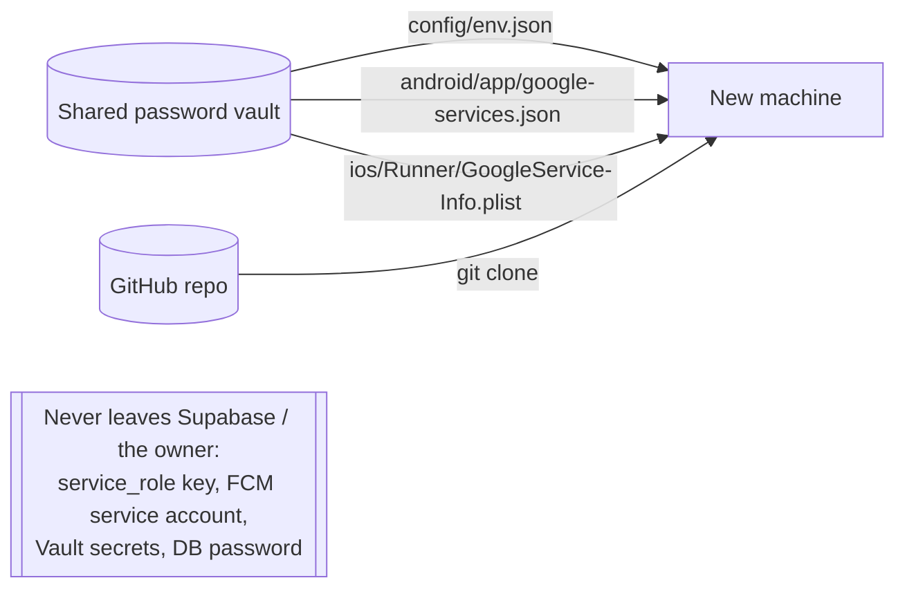

# SeeU — Developing on another computer

How to get the project running on a new machine, which files must be shared **privately**
(they are not in git), and which secrets must **never** be shared. Identifiers and URLs:
[`SETUP.md`](SETUP.md). Database: [`DATABASE.md`](DATABASE.md).

## 1. Tools

| Tool | Version | Needed for |
| --- | --- | --- |
| Flutter (includes Dart) | 3.47+ (stable) | everything |
| Android Studio + Android SDK | SDK 37 | Android builds / emulator |
| Xcode + CocoaPods | Xcode 26 (macOS only) | iOS builds |
| Git + SSH key on GitHub | — | access to `Cocsleboss/seeyourb` (ask to be added as collaborator) |
| Supabase CLI | 3.x | only for database / Edge Function work |
| Node.js | 20+ | only for the SQL test harness (`supabase/tests`) |
| Python 3 | — | only to rebuild translations (`tool/i18n/build_arb.py`) |

## 2. Files to share privately

These files are git-ignored. Copy them from an existing developer machine through a
**password manager shared vault** (1Password, Bitwarden…) or another encrypted channel.
Never by plain email / chat, never committed.

| File | Put it at | Contains | Sensitivity |
| --- | --- | --- | --- |
| `env.json` | `config/env.json` (template: `config/env.example.json`) | Supabase URL, **publishable** key, deep-link settings | Low (the publishable key ships inside the app), but keep it out of git |
| `google-services.json` | `android/app/` | Firebase Android client config | Low–medium |
| `GoogleService-Info.plist` | `ios/Runner/` | Firebase iOS client config. **Required to build iOS** (the Xcode project references it) | Low–medium |



## 3. Never share (and never put in the app or in git)

| Secret | Lives in | Who needs it |
| --- | --- | --- |
| Supabase **secret / service_role** key | Supabase dashboard; auto-provided to Edge Functions | nobody on a dev machine |
| Database password | Supabase dashboard | use `supabase login` instead |
| Firebase service account (`FCM_SERVICE_ACCOUNT`) | Supabase → Edge Functions → Secrets | only whoever redeploys `dispatch` (re-download it from Firebase if needed) |
| Vault `dispatch_secret` / function secret `DISPATCH_SECRET` | Supabase | nobody |
| Future release keys (Android upload keystore + passwords, Apple certificates / APNs `.p8`) | password vault | release manager only |

Instead of sharing passwords, **invite people**: Supabase → Organization → Members,
Firebase → Users and permissions, GitHub → Collaborators, Apple Developer team (when paid).
If a secret leaks: rotate it in its dashboard, then update the function secret.

## 4. First run

```sh
git clone git@github.com:Cocsleboss/seeyourb.git && cd seeyourb
git checkout flutter
# copy the three private files (section 2)
flutter pub get
flutter run --dart-define-from-file=config/env.json        # pick a device
```

- Generated translation files (`lib/l10n/`) are committed; after editing
  `tool/i18n/strings/*.txt` run `python3 tool/i18n/build_arb.py && flutter gen-l10n`.
- Checks before each commit: `flutter analyze` and `flutter test`.

### iOS signing

The project is signed with the free Personal Team `52HGFA36M9`, and the bundle id
`com.seeuapp.mobile` belongs to it. Another person cannot sign the same bundle id with
their own free team. Options:
1. Join a **paid** Apple Developer team (recommended, also needed for push / TestFlight), or
2. Locally only: Xcode → Runner → Signing & Capabilities → your team + a temporary bundle id
   (e.g. `com.seeuapp.mobile.dev-yourname`). **Don't commit** that change to
   `ios/Runner.xcodeproj/project.pbxproj`. Push won't work with it.

### Android

Debug and current release builds use each machine's own debug keystore: nothing to share
until a real release keystore exists (see SETUP "Still to do").

## 5. Database and server work (optional)

```sh
supabase login                                   # your own Supabase account (invited to the org)
supabase link --project-ref klqzmegiydmwtmxfguvl
supabase db query --remote --read-only "select count(*) from profiles"   # check access
```

- **There is only one Supabase project and it is production.** Never apply a migration or
  deploy a function without agreement; test migrations first with the throw-away database
  (`supabase/tests/README.md`). A separate dev project is recommended before more people join.
- Apply: `supabase db push --remote --yes`. Deploy: `supabase functions deploy dispatch --remote --yes`.

## 6. Checklist for a new developer

- [ ] GitHub collaborator + SSH key
- [ ] Tools installed (section 1), `flutter doctor` clean for the target platforms
- [ ] `config/env.json`, `google-services.json`, `GoogleService-Info.plist` received privately
- [ ] App runs on an Android device / emulator
- [ ] iOS signing solved (paid team or local bundle id)
- [ ] (DB work) invited to Supabase org, `supabase link` done
