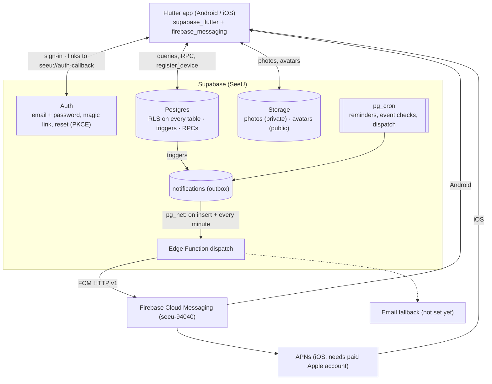

# SeeU — Configuration reference

Everything that ties the app, Supabase and Firebase together: identifiers, URLs,
secrets (names and where they live, **never their values**), and how the pieces talk.
Setup instructions are in the [README](../README.md); this page is the map.

## 1. Identifiers

| What | Value | Where it is set |
| --- | --- | --- |
| App name | SeeU | `android/app/src/main/AndroidManifest.xml` (`android:label`), `ios/Runner/Info.plist` (`CFBundleDisplayName`) |
| Android package / applicationId | `com.seeuapp.mobile` | `android/app/build.gradle.kts` (`namespace`, `applicationId`), Kotlin package `android/app/src/main/kotlin/com/seeuapp/mobile/` |
| iOS bundle ID | `com.seeuapp.mobile` | Xcode → Runner target (`PRODUCT_BUNDLE_IDENTIFIER` in `ios/Runner.xcodeproj/project.pbxproj`) |
| iOS test target bundle ID | `com.seeuapp.mobile.RunnerTests` | same file |
| Apple development team | `52HGFA36M9` (free Personal Team for now) | Xcode → Signing & Capabilities (`DEVELOPMENT_TEAM`) |
| Dart package name | `seeu` | `pubspec.yaml` (internal only, never shown to users) |
| Supabase project | **SeeU**, ref `klqzmegiydmwtmxfguvl`, region eu-central-1 | supabase.com dashboard; local link in `supabase/.temp/` (git-ignored) |
| Supabase URL | `https://klqzmegiydmwtmxfguvl.supabase.co` | `config/env.json`, Vault secret `project_url` |
| Firebase project | **SeeU**, id `seeu-94040` | console.firebase.google.com |
| Firebase Android app | `com.seeuapp.mobile` | `android/app/google-services.json` |
| Firebase iOS app | `com.seeuapp.mobile` | `ios/Runner/GoogleService-Info.plist` |

> Rejected IDs, kept for history: `app.seeu` and `com.seeuapp.seeu` were already
> registered by someone else at Apple.

## 2. URLs and deep links

The app owns the custom URL scheme **`seeu://`**
(Android: intent filter in `AndroidManifest.xml`; iOS: `CFBundleURLTypes` in `Info.plist`).

| URL | Used for | Configured in |
| --- | --- | --- |
| `seeu://auth-callback` | Sign-up confirmation, magic link, password reset emails: Supabase redirects here after verifying the link, the app exchanges the code for a session (PKCE) | `config/env.json` → `AUTH_REDIRECT`; Supabase → Authentication → URL Configuration (**Site URL** and **Redirect URLs**) |
| `<SHARE_LINK_BASE>/u/<username>` | Profile link ("Copier le lien", "Partager", QR code, "Ajoute-moi sur SeeU : @andrea"): opens that profile in the app | `config/env.json` → `SHARE_LINK_BASE` (`seeu://app` today, `https://<domain>` once the website is live) |
| `<SHARE_LINK_BASE>/e/<event id>` | Event link (⋯ → "Partager l'événement", public and "Entre amis" events) | same |
| `seeu://app/friends?q=<username>` | Older share links: Friends tab with the search prefilled (still handled) | — |
| `https://<domain>/u/…`, `/e/…` | Android App Links (intent filter with `autoVerify`, host from `seeu.linkHost` in `android/gradle.properties`) and iOS Universal Links (Associated Domains, needs the paid account). Verification files: [`deeplinks/`](../deeplinks/README.md), served by the website | `android/gradle.properties`, Xcode capability |
| `https://seeu.app` (placeholder) | "Envoyer le lien de l'app" to people without the app | `config/env.json` → `APP_DOWNLOAD_URL` |
| `https://klqzmegiydmwtmxfguvl.supabase.co/functions/v1/dispatch` | Called by the database to deliver notifications | built from Vault `project_url` in `request_dispatch()` |
| `https://fcm.googleapis.com/v1/projects/seeu-94040/messages:send` | Push sending (FCM HTTP v1) | built from `FCM_SERVICE_ACCOUNT.project_id` in the `dispatch` function |

In-app paths (also used as notification targets): `/`, `/contacts`, `/contacts/<id>`,
`/contacts/new`, `/contacts/import`, `/rdv/new?contact=<id>`, `/rdv/<id>`, `/friends`,
`/history`, `/settings`, `/settings/public-profile`, `/u/<username>`, `/event/<id>` (`/e/<id>` redirects there).

A link opened while signed out is remembered (2 days, `lib/core/links.dart`): the app shows
the sign-up screen with a banner, then opens the profile / event once the account is ready.

> Before the public launch: custom schemes aren't clickable in most messaging apps.
> With the website's domain: `SHARE_LINK_BASE=https://<domain>`, `seeu.linkHost=<domain>`,
> serve the two files of `deeplinks/.well-known/` (fingerprints and Team ID filled in), add the
> Associated Domains capability in Xcode, and point `APP_DOWNLOAD_URL` (and optionally the auth
> redirect) to it. Details: [`deeplinks/README.md`](../deeplinks/README.md).

## 3. Secrets and config files

| Name | Contains | Lives in | In git? |
| --- | --- | --- | --- |
| `config/env.json` | `SUPABASE_URL`, `SUPABASE_PUBLISHABLE_KEY` (public by design), `AUTH_REDIRECT`, `SHARE_LINK_BASE`, `APP_DOWNLOAD_URL` | your machine; template `config/env.example.json` | No |
| `android/app/google-services.json` | Firebase Android client config | your machine | No |
| `ios/Runner/GoogleService-Info.plist` | Firebase iOS client config (the Xcode project references it: needed to build iOS) | your machine | No |
| Vault `project_url` | Supabase URL, so the DB can call Edge Functions | Supabase → Vault | — |
| Vault `dispatch_secret` | Shared secret DB → `dispatch` function | Supabase → Vault | — |
| Function secret `DISPATCH_SECRET` | Same value as Vault `dispatch_secret` | Supabase → Edge Functions → Secrets | — |
| Function secret `FCM_SERVICE_ACCOUNT` | Firebase service account JSON (`firebase-adminsdk-…`) | Supabase → Edge Functions → Secrets | — |
| Function secrets `EMAIL_FROM` + `BREVO_API_KEY` or `RESEND_API_KEY` | Email fallback for notifications | not set yet | — |
| `SUPABASE_URL`, `SUPABASE_SERVICE_ROLE_KEY` | Admin access inside functions | provided automatically by Supabase | — |

Never put the Supabase **secret / service_role** key or the Firebase service account in the app.

## 4. How the pieces connect



The `delete-account` Edge Function (called by the app from Settings) deletes the user's
storage files and account.

- **Auth**: email + password, magic link, password reset; PKCE flow; sessions stored on device.
- **Data**: every query goes through Row Level Security; sharing between friends only through
  `SECURITY DEFINER` functions (`send_friend_request`, `send_rdv_invite`, `respond_rdv_invite`, …).
- **Photos**: private bucket `photos`, one folder per user (`<user_id>/<random>.jpg`), read through
  signed URLs (1 h). Shared rendezvous photos are readable by the other participants (storage policy
  `photos_storage_select_shared`).
- **Push tokens**: the app calls `register_device(token, platform)`; tokens are stored in
  `device_tokens`; `dispatch` deletes tokens FCM reports as invalid.
- **Scheduled jobs** (pg_cron): `seeu-reminders` and `seeu-event-checks` (`*/10 * * * *`), `seeu-dispatch` (`* * * * *`).
- **Database structure** (tables, keys, diagrams): [`DATABASE.md`](DATABASE.md).

### Events, visibility and who may publish public events

- `events` holds the shared part of a rendezvous (organizer, visibility, date, place,
  timeslot poll); every participant keeps their own `rendezvous` row (`event_id`).
- **Visibility**: `private` (invited friends only), `contacts` (all the organizer's
  SeeU friends see it in Home → Entre amis and can join; they get a notification),
  `public` (everyone, Home → Explorer; only the organizer posts announcements and photos).
- **Public event creators** are listed in `public.public_event_creators` (no app access).
  To allow someone, run in the SQL editor:

  ```sql
  insert into public.public_event_creators (user_id, note)
  select id, 'why / who approved' from public.profiles where username = 'their_username';
  ```

  To remove: `delete from public.public_event_creators where user_id = (select id from public.profiles where username = 'their_username');`
  The app shows the "Public" choice to that person at the next refresh.
- **Chat**: `event_messages`, live through Supabase Realtime (the migration adds the table
  to the `supabase_realtime` publication).
- **Mutes / blocks**: `user_mutes` (a person or one event) and `user_blocks`; both are
  applied centrally in `enqueue_notification` and in the feeds. Users manage them in
  Réglages → Masqués et bloqués.

### Reports, admins and bans (migration 0012)

- **Reports**: "Signaler" on a profile, an event (⋯), a chat message (long press) or a photo
  (viewer); reason from a closed list + optional comment, optionally "Bloquer aussi".
  Stored in `public.reports`; the reporter only sees their own.
- **Admins** (the website's `/admin`, step 2): listed in `public.admins`, managed in the SQL editor:

  ```sql
  insert into public.admins (user_id, note)
  select id, 'who / why' from public.profiles where username = 'their_username';
  ```
- **Bans**: only through `admin_ban_user` (website). Sets `profiles.banned_at`, sets
  `auth.users.banned_until` and revokes the sessions, and the PostgREST pre-request hook
  (`pgrst.db_pre_request = public.seeu_pre_request` on the `authenticator` role, set by the
  migration) refuses every request of that account. The app shows "Compte suspendu".
  Check the hook after deploying: `select rolconfig from pg_roles where rolname = 'authenticator';`
- **Activity**: the app calls `touch_session()` at launch, on resume and every 4 minutes
  while open (`lib/core/activity.dart`); `admin_stats()` turns it into the dashboard figures.

### Profiles, city of residence, travel hints (migrations 0013–0014)

- Réglages → Profil: bio and city of residence (place search restricted to cities).
  Réglages → Profil → **Profil public et partage**: link (copy / share / QR code), public page
  on/off (off by default), visible fields, events shown (none / chosen / all, public events
  only), "Mes amis voient ma ville".
- Contact cards get a city too (people without an account).
- An event ≥ 40 km from home shows who lives there (event page + form), and
  `seeu-travel-hints` pushes it a few days before (`notify_travel`, Réglages → Notifications).
  Deploy `dispatch` again for the `travel_nearby` text.

### Languages

- App strings: `tool/i18n/strings/*.txt` (one line per string: `key | Français | English`),
  then `python3 tool/i18n/build_arb.py && flutter gen-l10n`.
- Notifications are stored as `kind` + `params` and rendered by `dispatch`
  (`supabase/functions/dispatch/templates.ts`) in the recipient's `profiles.locale`
  and time zone.
- **Adding a language**: a column in the strings files + `LANGS` in `build_arb.py`,
  `appLanguages` in `lib/core/i18n.dart`, `CFBundleLocalizations` + an `xx.lproj/InfoPlist.strings`
  on iOS, and a template block in `templates.ts`.
- Auth emails (sign-up confirmation, reset) are configured in the Supabase dashboard and are
  single-language. The sign-up sends `locale` in the user metadata, so the templates can switch
  on it (`{{ if eq .Data.locale "en" }}…{{ else }}…{{ end }}`).

### Photos

Compressed on the phone before upload: 720 px on the short side, JPEG quality 70, metadata
(EXIF, GPS) removed, plus a 256 px thumbnail (`photos.thumb_path`) used in grids and the
calendar. Contact pictures are 384 px. Photos uploaded before this change keep their size.

## 5. Platform accounts

| Service | What it's used for | Status |
| --- | --- | --- |
| Supabase | Database, auth, storage, Edge Functions, cron | ✅ configured (incl. auth redirect URLs) |
| Firebase | Push only (Cloud Messaging) | ✅ Android + iOS apps registered, service account set |
| Apple Developer (free Personal Team) | Running on your iPhone (7-day signing) | ✅ |
| Apple Developer Program (paid) | iOS push (APNs key), TestFlight, App Store | ❌ not yet |
| Google Play Console | Android release | ❌ not yet |
| Email provider (Brevo / Resend) | Notification email fallback, and custom SMTP for auth emails (Supabase's built-in mailer is rate-limited) | ❌ not yet |

## 6. Still to do

- [x] Supabase → Authentication → URL Configuration: Site URL + Redirect URL `seeu://auth-callback`.
- [ ] Paid Apple account → Xcode: add **Push Notifications** capability; developer.apple.com → APNs key
      (`.p8`) → upload in Firebase → Project settings → Cloud Messaging (Key ID + Team ID).
- [ ] Email provider: `EMAIL_FROM` + API key as function secrets; custom SMTP in Supabase Auth.
- [ ] Domain for share links / App Links / Universal Links (website, step 2): fill and serve `deeplinks/.well-known/*`, set `SHARE_LINK_BASE`, `seeu.linkHost`, Associated Domains.
- [ ] Apply migrations `0012`–`0014` (and `0010`–`0011` if still missing), redeploy `dispatch` (new `travel_nearby` text), add the first admin: step-by-step guide in French for the project owner in [`MIGRATION_ETAPE1.md`](MIGRATION_ETAPE1.md).
- [ ] Android release signing (replace the debug signing config in `android/app/build.gradle.kts`).
- [ ] Ads: see `docs/ADS.md` (AdMob account, consent flow, AdsService implementation).
- [ ] Auth email templates in French + English (see "Languages" above).

## Maps & place search

- Map tiles: OpenStreetMap's public server (`lib/maps/maps.dart`, `_tileUrl`), used per its
  [tile usage policy](https://operations.osmfoundation.org/policies/tiles/): exact URL, app
  User-Agent `SeeU/1.0 (com.seeuapp.mobile)`, attribution always visible, flutter_map's
  built-in cache (honours the server's cache headers), no prefetch / offline areas.
  The service has no SLA and can block an app without notice: **before a public launch,
  switch `_tileUrl` to a provider with a key** (MapTiler, Stadia, Thunderforest…).
- Place search: Photon (komoot), biased towards the phone's approximate position
  (asked once; rounded to ~1 km before being sent), else the area of the user's events.
