# SeeU — Website (public pages)

What the SeeU website must do for the app's shared links. Not covered here: the admin
interface (see [`prompts/ETAPE_2_SITE.txt`](prompts/ETAPE_2_SITE.txt), part 2) and the
backend reference ([`API_SITE.md`](API_SITE.md)).

**The domain isn't chosen yet.** Below, `<site>` is the website's address. It's a variable
everywhere:

| Where | Setting |
| --- | --- |
| App | `WEBSITE_URL` in `config/env.json` (default placeholder `https://seeu.app`, no trailing slash) |
| Android App Links | `seeu.linkHost` in `android/gradle.properties` |
| iOS Universal Links | Xcode → Runner → Signing & Capabilities → Associated Domains `applinks:<domain>` (paid Apple account) |
| Website | its own config (e.g. `SITE_URL`), used for canonical URLs and Open Graph tags |

## 1. What every page shares

- **Mobile first.** Most visitors arrive from a phone, through WhatsApp, Messenger, Instagram or SMS.
- **Server-side rendered**, with Open Graph / Twitter tags (title, description, image), so link
  previews look right in messaging apps.
- **French by default, English available** (`Accept-Language`, plus a switch). Same tone as the app.
- **Supabase publishable (anon) key only.** Call only the RPCs listed in §4. Never use the
  `service_role` key and never read tables directly.
- **"Not found" pages** never say why: unknown, disabled, banned or revoked all look the same.
- **Invitation and profile pages** get `noindex` (they're for people who received the link, not
  for search engines), and `Referrer-Policy: no-referrer` (invitation tokens must not leak to
  third-party sites through the `Referer` header).

### Opening the app ("Ouvrir dans SeeU")

```mermaid
flowchart TD
  A[Someone taps https://site/...] --> B{App installed and<br/>domain verified?}
  B -->|yes| APP[The OS opens the app directly on that page<br/>App Links / Universal Links: the site isn't even loaded]
  B -->|no, or not verified yet| W[Website page: preview + button]
  W -->|"Ouvrir dans SeeU"| T[Try seeu://app/same-path]
  T -->|app opens| APP
  T -->|nothing after ~1.5 s,<br/>page still visible| S[Show the store buttons<br/>App Store or Google Play, by platform]
  S --> I[After installing: reopen the link<br/>it then opens the app]
```

Each page has an app path, the same path on the app's scheme: `https://<site>/@andrea` ↔
`seeu://app/@andrea`, and `https://<site>/j/<token>` ↔ `seeu://app/j/<token>`.

- Only try `seeu://` **after a tap** (browsers block an automatic custom-scheme redirect, or
  show an error).
- **Android:** use an intent URL, which falls back to the Play Store by itself:
  `intent://app/j/<token>#Intent;scheme=seeu;package=com.seeuapp.mobile;S.browser_fallback_url=<encoded store URL>;end`.
- **iOS:** set `location.href = 'seeu://app/...'`. If the page is still visible after about
  1.5 s (`visibilitychange` didn't fire), show the App Store button.
- **Keeping the destination:** there's no deferred deep link yet. Show "Après l'installation,
  rouvrez ce lien" and a QR code of the same URL (for a visitor on a computer). Optionally later,
  pass the path in the Play Store `referrer` parameter.
- **The app already handles the rest.** Signed out, it remembers the page (2 days) and shows the
  sign-up screen with a banner, then opens the profile or event once the account is ready.

## 2. Pages

### `/` — Home

- A short presentation of SeeU (keep in touch with the people who matter, plan events with
  friends), with screenshots.
- App Store and Google Play buttons (`APP_DOWNLOAD_URL` in the app points here).
- Links to the privacy policy and terms (needed for the stores) and a contact address.

### `/@<username>` — Public profile

Example: `https://<site>/@andrea`. The app shares this link (copy, share sheet, QR code) **only
when the person turned their public profile on** (Réglages → Profil public et partage). Without
a public profile there's no page: they can only be found and added from the app (search by
@username).

- **Data:** `get_public_profile(p_username)`. Accepts `andrea`, `@andrea` or `Andrea`.
  - Returns `null` when the profile doesn't exist, is off, or is banned → "Profil introuvable" page.
  - Shows **only** what the person chose: photo, display name, city, bio. Each field is `null`
    when hidden. The @username is always there (it's the address).
  - Photo: `${SUPABASE_URL}/storage/v1/object/public/avatars/${avatar_path}`. Without one, show
    initials on a colored circle, like the app.
- **Main button:** "Ajouter @andrea sur SeeU" → opens the app on the profile, where the visitor
  taps "Ajouter en ami SeeU". This creates a friend request, which the other person accepts.
- **Secondary:** store buttons and the QR code (§1).
- **Open Graph:** title "Andrea (@andrea) sur SeeU", description from the bio or a default
  sentence, image from the profile photo or a default SeeU image.
- **Events:** the RPC also returns `events` (the person's public events). Public events are
  hidden in the app for now, so **don't show an events section yet**.
- **Old links:** `/u/<username>` → permanent redirect (301) to `/@<username>`.

### `/j/<token>` — Invitation to an event

Example: `https://<site>/j/q8H2…` (43 random characters, `[A-Za-z0-9_-]`). The organizer
creates the link from the event ("Inviter avec un lien"). Guests can create one too when the
organizer allows guests to invite. **Anyone holding the link can join the event**, even without
being a SeeU friend: the app says so clearly when the link is created. Works for private and
"Entre amis" events.

- **Data:** `get_link_preview(p_token)` (anonymous).
  - Returns `null` when the link is unknown, was disabled or replaced, the event was deleted, or
    whoever created it may no longer invite → "Ce lien d'invitation ne fonctionne plus" page.
  - Fields:
    - `title`, `location`, `description`;
    - `starts_at` (null while the date is being chosen, then `slots_open` is true: show "Date à
      choisir");
    - `status` (`annule`: show "Événement annulé" and no join button);
    - `going` (number of people going);
    - `organizer_name`, `organizer_avatar_path`.
  - Never returned: participants, exact coordinates, ids.
- **Page:**
  - "Andrea vous invite" header;
  - title, date and time (in the visitor's time zone), place, description, "6 participants";
  - main button **"Rejoindre dans l'app"** (§1).
  - The visitor answers in the app: "Je viens", "À confirmer", or gives their availability when
    the date isn't fixed. The app then notifies the organizer, and the guest who shared the link
    if it was theirs. The organizer can see who came through a link and remove them.
  - No answering on the website (an account is needed).
- **Open Graph:** title "Andrea vous invite : <title>", description "<date> · <place>". The
  preview is visible to whoever receives the link: that's expected, they could join anyway.
- **Security:** never log full tokens (log the first 6 characters at most). Don't put the
  token in analytics URLs. Send `Referrer-Policy: no-referrer`.

### `/e/<event id>` — Public event (later)

Public events are hidden in the app for now. Keep the route: `get_public_event(p_event)`
returns `null` unless the event is public. Same layout as `/j/`, with a "Rejoindre" button that
opens `seeu://app/e/<id>`. Build it when public events come back.

### `/.well-known/assetlinks.json` and `/.well-known/apple-app-site-association`

- Serve them from [`deeplinks/.well-known/`](../deeplinks/README.md) **as is**: HTTPS, status
  200, `Content-Type: application/json`, no redirect (not even to `www`).
- No file extension on the Apple one.
- They declare `/@*`, `/j/*`, `/u/*` and `/e/*` as app paths.
- Fill in the Android signing fingerprints and the Apple Team ID before launch (see the deeplinks
  README).

## 3. Checks before launch

- [ ] On a phone **with** the app: tapping `https://<site>/@andrea` and `https://<site>/j/<token>`
      in WhatsApp opens the app directly, on the right page.
- [ ] **Without** the app: the page shows the preview; "Ouvrir dans SeeU" leads to the right
      store. After installing and signing up, reopening the link lands on the profile or event.
- [ ] A disabled or replaced invitation link, a profile that's off, and an unknown username all
      show "introuvable" or "ne fonctionne plus", with no reason given.
- [ ] Link previews (WhatsApp, Messenger, iMessage) show the title and image.
- [ ] No participant names, ids or coordinates in the HTML of `/j/` pages.
- [ ] `WEBSITE_URL` in the app and `seeu.linkHost` match the real domain, and Associated Domains
      is set in Xcode.

## 4. Backend calls used by these pages

All anonymous, with the publishable key. Details in [`API_SITE.md`](API_SITE.md).

| RPC | Page | Returns |
| --- | --- | --- |
| `get_public_profile(p_username text)` | `/@<username>` | jsonb or `null` |
| `get_link_preview(p_token text)` | `/j/<token>` | jsonb or `null` |
| `get_public_event(p_event uuid)` | `/e/<id>` (later) | jsonb or `null` (malformed id: error `22P02`, treat as not found) |
